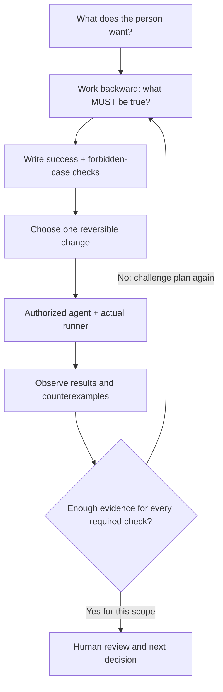
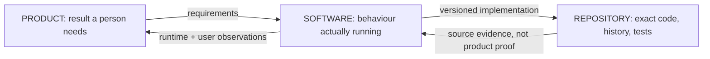
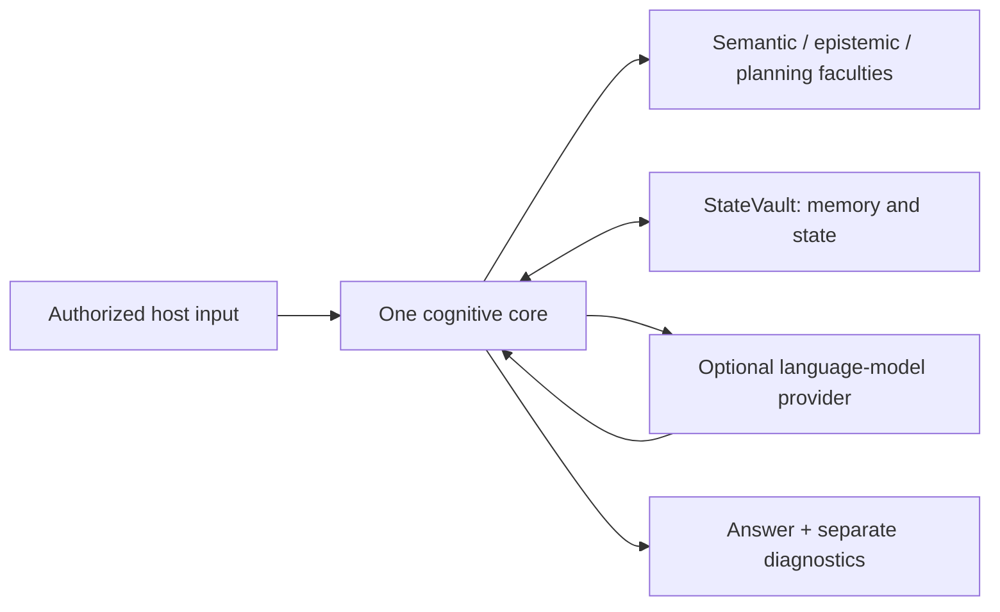
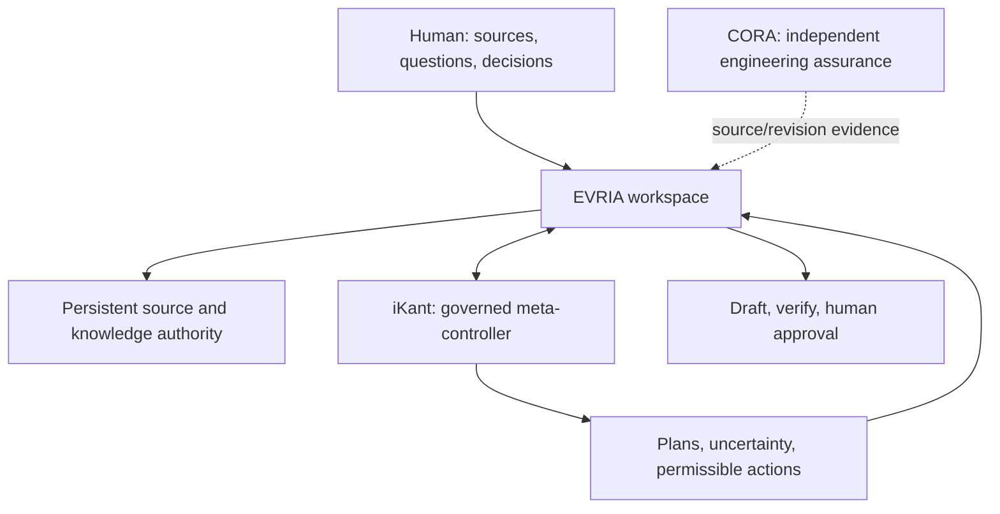

<!-- programme-header:v2 -->
> **AOSP programme** — [Hub](https://github.com/Luke883i/academics) · [ROA theory](https://github.com/Luke883i/ROA) · [CORA engineering](https://github.com/Luke883i/cora). Every repository is independently readable. Membership does not imply formal derivation, shared runtime, scientific validation, certification, or production readiness. Repository-local code, evidence, and governance remain authoritative.

# AOSP — Augmented Ontological Semantic Platforms

A public point of entry to an independent research and engineering programme: the person, the theory, the experimental software and the evidence.

## 1. Founder and academic trajectory

**Gianluca Conte** — Multidisciplinary team leader across consulting, pharmaceuticals, healthcare and higher education, including C-level coordination. Combines audit, compliance and information-security work with accounting, statistics, applied mathematics and responsible-AI research. Contributes to professional communities and standards; interested in philosophy of science, travel and well-being.

| Year | Institution | Academic programme and focus | Original thesis |
| --- | --- | --- | --- |
| **2009** | University of Pisa | M.Sc. Applied Mathematics for Economics; game theory and social negotiation | [Game theory in social negotiations](theses/2009-game-theory-social-negotiations.pdf) |
| **2011** | University of Pisa | M.Sc. Audit & Corporate Criminal Law; corruption risk and organizational control | [Corruption-risk management](theses/2011-corruption-risk-management.pdf) |
| **2022** | University of Milan | M.Sc. Cybersecurity; information-security organization, governance and control | [Security organization, governance and control](theses/2022-information-security-governance.pdf) |
| **2025** | University of Udine | Postgraduate diploma, Philosophy of AI & Information; reticular representations | [Reticular local abstraction and epistemic convolutions](theses/2025-reticular-local-abstraction.pdf) |

These original PDFs document the author's academic trajectory; they do not prove the later theory or validate software. Qualifications and profile are author-reported.

## 2. ROA — theoretical research programme

**[ROA — Reticular Observer Architectures](https://github.com/Luke883i/ROA)** studies how bounded human or computational observers form and revise representations under incomplete evidence. Its research topics include epistemic horizons, provenance, admissibility of claims, uncertainty and controlled reification.

**Plain-language idea:** a model's description is not the world; an AI answer is not automatically evidence; evidence does not grant permission; execution does not establish the real-world result. ROA is an evolving theoretical corpus, not an independent scientific validation of the applications below.

## 3. AOSP — engineering programme

**AOSP (Augmented Ontological Semantic Platforms)** is the umbrella programme for experiments in persistent knowledge, governable cognition, AI-assisted software engineering and domain applications. Its participants are independently governed repositories—not a single deployed platform.

The objective is practical: make AI-assisted work useful while retaining sources, authority boundaries, known gaps and the evidence required to justify decisions. Potential applications include financial and internal audit, risk and compliance, professional services, enterprise knowledge management and education. These are prospective markets, not claims of professional certification or autonomous audit judgement.

## 4. CORA — flagship experimental witness

**[CORA — Continuous Ontological Repository Assurance](https://github.com/Luke883i/cora)** is AOSP's **flagship experimental engineering product**: an agent-agnostic method, plus an optional local Python assurance engine, for guiding AI coding agents from a human outcome to inspectable engineering evidence. It does not itself write features, run merely because a prompt was pasted, approve changes or certify an application.

### The problem in everyday language

Suppose someone asks an AI: *“Make an app where a customer reports a problem, can find the report tomorrow, and cannot close somebody else's case.”* The AI may quickly draw a convincing screen. But did it save the information? Does it survive a restart? Can the wrong person close it? Which exact version was tested?

CORA treats these as separate questions. A beginner chooses the desired result and reviews decisions; a coding agent proposes small changes; actual Git and test runners supply the evidence when available.

### Diagram 1 — work backward, verify forward

**Backward derivation** starts from the desired result, not from whichever feature the agent wants to code first. **Ongoing roadmap re-falsification** asks after each change whether the original plan is still justified. New failures, unknown consumers or changed requirements reopen the relevant tasks.

### Diagram 2 — three distinct kinds of truth

| Layer | Example question | What would demonstrate it? |
| --- | --- | --- |
| **Product** | Can the customer actually recover a submitted case? | A valid user journey in the intended environment. |
| **Software** | Is the record still there after a real process restart? | Original datastore restart and readback tests. |
| **Repository** | Which exact implementation did we examine? | Git blobs, commit identity and revision-bound test receipts. |

A green CI check and a correct Git hash are not sufficient evidence that people can use the product. Nor can a document or receipt approve its own release.

### CORA's method, in practical terms

1. **Backward AND-DoD:** state the outcome and derive necessary, non-compensatory checks across source, target runtime and external acceptance. Each critical check has a counterexample.
2. **Small semantic slices:** pick the smallest change that protects behavior, data ownership, permissions, interfaces and rollback.
3. **Blobbing / Git materialization:** bind proposed and observed code to exact Git blobs, trees and commits. A draft is not a materialized change.
4. **Native tests and adversarial mutation:** execute target-owned positive and negative tests; deliberately introduce disposable source faults to check the checker. Keep survivors visible.
5. **Finite saturation:** explore declared families of faults and a separately specified no-new-failure-class tail. Large simulation counts never become universal correctness.
6. **Re-falsify the roadmap:** inspect the new HEAD, redo the requirements/dependency frontier, select the next unresolved leaf and stop on missing authority or tests.
7. **Evidence-bound continuation:** present PASS_SCOPED, REFUTED, NOT_RUN or BLOCKED_EXTERNAL for the exact source scope, with an intelligible next choice.

**For a non-specialist:** describe a goal in a ChatGPT Project, inspect the proposed checks, authorize bounded work and read the results. ChatGPT Projects (including eligible Plus and Edu accounts) are an entry point to **CORA-METHOD**, not a coding runner. Real source changes need an authorized agent; native tests and CORA-ENGINE need an approved execution environment.

CORA does **not** seek superiority over well-designed engineering checklists. The experimental question is whether non-experts can coordinate rigorous engineering with AI help—possibly at substantial cost from mutations, blobbing, saturation and evidence handling. Human understanding, reduced error and economic benefit remain hypotheses to test independently.

### Five concrete examples — original Git commits

These examples are drawn from the [*From Intent to Evidence* research dossier](https://github.com/Luke883i/cora/tree/main/research/decision-ready-assurance). The links point to verified original Git commits and show what was changed in source. They **do not** prove CORA caused every patch, that a deployment passed, or that a user study was conducted.

**1. A saved record must survive a restart — ICTC.** [Commit `80a1e71b98`](https://github.com/Luke883i/ictc/commit/80a1e71b98f63a9f5a30d4398eefaadea27ba39c) added same-SQLite process-restart invariants for seven procedures. This addresses a different question from “did clicking Save show success?” A meaningful oracle writes, restarts the actual service and reads back the same data. The commit proves the test source changed; the relevant runtime result still needs an execution receipt.

**2. A valid page must not be mistaken for an attacker — Teddy.** [Commit `f04a124ac0`](https://github.com/Luke883i/teddy/commit/f04a124ac024988c1a55884be1560b156f6e574f) adjusted trusted TLS proxy origin and CSRF handling; [commit `2401716db9`](https://github.com/Luke883i/teddy/commit/2401716db9b19da2a9a4eada7b702923bcea0cb8) added an actual local/forwarded-port 403 regression reproduction. The engineering goal has two sides: let an authorized browser communicate and continue rejecting forged origins. “The chat UI loads” is not the entire security requirement.

**3. An empty list must be genuinely empty — LUMEN.** [Commit `1ccb6fd0f7`](https://github.com/Luke883i/lumen/commit/1ccb6fd0f7b74832a2f5bf64e27e38704e15cb30) requires confirmed absence plus one truthful recovery action. A network failure and an empty catalogue must not generate the same misleading product message. The expected error state is part of the user-facing contract.

**4. A button press must reach the game — NILO.** [Commit `32e7935fbf`](https://github.com/Luke883i/NILO/commit/32e7935fbf425c7c513c95862c019230e74d014c) preserves the physical jump latch across state boundaries and sub-tick press edges. A correct-looking event handler does not show that a player's short press survives actual frame timing. Browser and player observation remain stronger evidence than source inspection.

**5. Test the test — CORA itself.** [Commit `4db17ab598`](https://github.com/Luke883i/cora/commit/4db17ab598c1bfbee823d5161c536c29818fa181) corrected physical JSON mutation inputs before replay; [commit `f98690d0b1`](https://github.com/Luke883i/cora/commit/f98690d0b19b9e40dae05ebfccb70afedaee2bbc) strengthened a checker to discriminate composite mutation survivors. A false or malformed mutant can make an assurance report misleading. The oracle needs its own negative controls.

**An informative null result:** in an author-selected study, CORA's evidence model and a strong executable checklist tied on **16/16 fixed cases**. A retrospective sample of 11 PRs across five repositories recorded 92 applicable evidence obligations, with 70 *not observed in that dossier* (not 70 proven defects). Forty-four modeled briefings were generated; **no people were tested**. These numbers are a research boundary, not marketing proof of better engineering.

## 5. iKant-EDU — cognitive model, stack and runtime

**iKant-EDU** is a distinct experimental **Node.js 22.13+** cognitive coordination system around a replaceable language model. It tests the *contribution* of coordinated functions—semantic analysis, epistemic limits, planning, reasoning, social context and reflective checks—not a claim of machine consciousness.

**One cognitive core (`cognitiveTurn`)** coordinates the faculties; **StateVault** is the bounded state/memory writer. An optional external language provider generates fluent text, without receiving authority over the session or memory.

**Actual stack:** a local Node core with native tests; **MCP stdio**, local **HTTP/demo**, a **session-chat** adapter and an opt-in **OpenAI Responses API** integration requiring credentials, network and authorization. A prompt cannot install an automatic ChatGPT→Node dispatcher. A five-arm same-model study proposes blinded utility and causal-uplift thresholds, still **BLOCKED_EXTERNAL / NOT_ATTESTED**.

**First-release target: Q1 2027**, subject to validation. The public [iKant_EDU](https://github.com/Luke883i/iKant_EDU) is a **separate research line**, not the private iKant-EDU runtime or proof of a completed release.

## 6. EVRIA — envisioned Epistemic Operating Environment

**EVRIA** is a *to-be* **Epistemic Operating Environment**: an OS-like workspace in which people collect sources, query knowledge, inspect evidence, draft documents and submit consequential actions to review.

**Target division of responsibility:** EVRIA owns the interaction experience; the knowledge substrate owns durable records; **iKant** governs cognitive planning and action boundaries as the **meta-controller**; CORA separately assesses engineering evidence. iKant-EDU may inform research but cannot silently replace the distinct iKant runtime.

**Observed limit:** EVRIA contains a local browser pilot backed by an append-only journal, not a verified integration of the original knowledge, iKant and CORA runtimes. Real identity, tenant separation, enterprise workflows and external usability remain open. EVRIA's repository is private; this overview does not grant access.

## 7. Experimental projects that challenged CORA's method

The following independently governed projects provided different **engineering problem classes** used to refine assurance questions. They are not evidence of one shared runtime or that CORA authored every commit.

| Project | Distinct engineering lesson | Original source |
| --- | --- | --- |
| [ICTC](https://github.com/Luke883i/ictc) | Persisted audit/compliance state, roles and evidence boundaries | [Restart invariants](https://github.com/Luke883i/ictc/commit/80a1e71b98f63a9f5a30d4398eefaadea27ba39c) |
| [Teddy](https://github.com/Luke883i/teddy) | CSRF/origin boundary, valid and invalid routes | [Security fix](https://github.com/Luke883i/teddy/commit/f04a124ac024988c1a55884be1560b156f6e574f) |
| [LUMEN](https://github.com/Luke883i/lumen) | Honest empty states, service recoverability | [Recovery UX](https://github.com/Luke883i/lumen/commit/1ccb6fd0f7b74832a2f5bf64e27e38704e15cb30) |
| [NILO](https://github.com/Luke883i/NILO) | Interactive timing, player experience, runtime vs source | [Input latch](https://github.com/Luke883i/NILO/commit/32e7935fbf425c7c513c95862c019230e74d014c) |
| [iKant_EDU](https://github.com/Luke883i/iKant_EDU) | AND requirements, host and runtime proof boundaries | [Outcome contract](https://github.com/Luke883i/iKant_EDU/commit/c7034b71c2efd3b03dc11921b4a55d35bf032fb0) |
| [CORA](https://github.com/Luke883i/cora) | Mutation oracles need falsification too | [Composite survivors](https://github.com/Luke883i/cora/commit/f98690d0b19b9e40dae05ebfccb70afedaee2bbc) |
| [Juriscribe](https://github.com/Luke883i/juriscribe) | **Closed and unmaintained** historical legal research; not suitable for operational reliance | [Historical source](https://github.com/Luke883i/juriscribe) |

## Evidence and archive

[Programme registry](PROGRAMME.json) · [Original academic PDFs](theses/) · [Historical baseline](history/README.md) · [CORA research dossier](https://github.com/Luke883i/cora/tree/main/research/decision-ready-assurance)

Git histories attest source identities; native test runs attest only what they exercised; external acceptance and human authorization remain separate. AOSP membership is not evidence of technical integration or product readiness.
