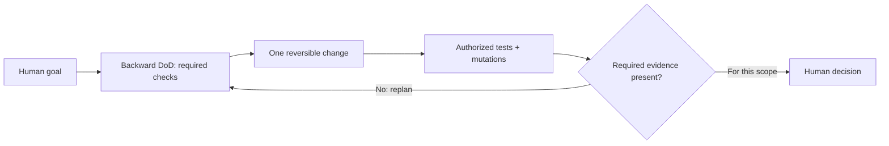
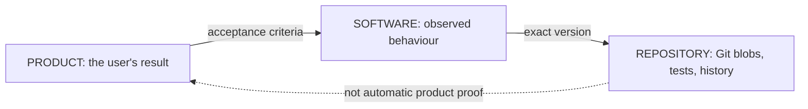

<!-- programme-header:v2 -->
> **AOSP programme** — [ROA theory](https://github.com/Luke883i/ROA) · [CORA engineering](https://github.com/Luke883i/cora). Every repository is independently readable. Membership does not imply formal derivation, shared runtime, scientific validation, certification, or production readiness. Repository-local code, evidence, and governance remain authoritative.

## Founder and academic trajectory

**Gianluca Conte** — Multidisciplinary team leader across consulting, pharmaceuticals, healthcare and higher education, including C-level coordination. Combines audit, compliance and information-security work with accounting, statistics, applied mathematics and responsible-AI research. Contributes to professional communities and standards; interested in philosophy of science, travel and well-being.

| Year | Institution | Academic programme and focus | Original thesis |
| --- | --- | --- | --- |
| **2009** | University of Pisa | M.Sc. Applied Mathematics for Economics; game theory and social negotiation | [Game theory in social negotiations](theses/2009-game-theory-social-negotiations.pdf) |
| **2011** | University of Pisa | M.Sc. Audit & Corporate Criminal Law; corruption risk and organizational control | [Corruption-risk management](theses/2011-corruption-risk-management.pdf) |
| **2022** | University of Milan | M.Sc. Cybersecurity; information-security organization, governance and control | [Security organization, governance and control](theses/2022-information-security-governance.pdf) |
| **2025** | University of Udine | Postgraduate diploma, Philosophy of AI & Information; reticular representations | [Reticular local abstraction and epistemic convolutions](theses/2025-reticular-local-abstraction.pdf) |

These original PDFs document the author's academic trajectory; they do not prove the later theory or validate software. Qualifications and profile are author-reported.

## Theoretical research programme (ROA)

**[ROA — Reticular Observer Architectures](https://github.com/Luke883i/ROA)** studies how bounded human or computational observers form and revise representations under incomplete evidence. Its research topics include epistemic horizons, provenance, admissibility of claims, uncertainty and controlled reification.

A model's description is not the world; an AI answer is not automatically evidence; evidence does not grant permission; execution does not establish the real-world result. ROA is an evolving theoretical corpus, not an independent scientific validation of the applications below.

## Engineering programme (AOSP)

**AOSP (Augmented Ontological Semantic Platforms)** is the umbrella programme for experiments in persistent knowledge, governable cognition, AI-assisted software engineering and domain applications. Its participants are independently governed repositories—not a single deployed platform.

The objective is practical: make AI-assisted work useful while retaining sources, authority boundaries, known gaps and the evidence required to justify decisions. Potential applications include financial and internal audit, risk and compliance, professional services, enterprise knowledge management and education. These are prospective markets, not claims of professional certification or autonomous audit judgement.

### Programme structure

**ROA** (theoretical research) → informs **AOSP** (engineering programme). The relationship is conceptual, not evidence of a shared runtime or formal scientific validation.

| AOSP initiative | Role within the programme | Status and limits |
| --- | --- | --- |
| **[CORA](https://github.com/Luke883i/cora)** | Flagship engineering method and optional local Python CLI | Experimental; benefits for non-specialists and superiority over strong checklists remain unproven. |
| **iKant-EDU** | Cognitive coordination research and Node.js runtime | Experimental; first release targeted for Q1 2027, subject to validation. |
| **EVRIA** | Proposed epistemic operating environment, with iKant as intended meta-controller | Envisioned; native integration and safe deployment are not demonstrated. |
| **⚠ [ICTC](https://github.com/Luke883i/ictc), [Teddy](https://github.com/Luke883i/teddy), [LUMEN](https://github.com/Luke883i/lumen), [NILO](https://github.com/Luke883i/NILO), [Juriscribe](https://github.com/Luke883i/juriscribe)** | Independent application prototypes developed with replaceable coding agents using CORA-METHOD | **EXPERIMENTAL ONLY** — not enterprise-ready; safe enterprise use and certification are not claimed. Juriscribe is closed and unmaintained. |

## Evidence-led software engineering (CORA)

**[CORA — Continuous Ontological Repository Assurance](https://github.com/Luke883i/cora)** is AOSP's flagship experimental method and optional Python 3.11+ assurance engine. It helps coordinate **replaceable AI coding agents**, not replace the coding agent, execute code from a prompt or authorize deployment.

Consider a customer-reporting application built with an AI coding agent. A Save button may look complete even if the report disappears after a restart, another customer can close it, or nobody can identify the tested version. CORA turns those risks into explicit checks.

### From requirements to evidence

The process starts with the intended outcome, derives the conditions needed to achieve it, and verifies each incremental change. A surviving counterexample requires reassessing the plan.

Product outcomes, executable behaviour and repository history are related, but not interchangeable. Passing tests on a Git revision does not, by itself, establish product acceptance.

CORA derives **conjunctive acceptance criteria** from the intended result: source requirements, executable behaviour and any independent user or external checks must each have appropriate evidence. Work proceeds in small, reversible changes; after every change, the requirements, dependencies and remaining tests are reassessed.

| Engineering technique | How it is applied | Evidence boundary |
| --- | --- | --- |
| **Content-addressed version control** | Git blob, tree and commit hashes identify the exact files and revision under examination; test receipts can refer to that revision. | A matching hash identifies source bytes, not correct behaviour or human approval. |
| **Mutation testing** | Controlled defects are introduced into disposable copies of real source or test logic. Positive and negative tests should detect them; undetected mutations remain visible. | Detection depends on the chosen operators, tests and runtime actually executed. |
| **Combinatorial fault testing and bounded convergence analysis** | Reproducible, seeded scenarios vary declared failure conditions against independently specified expected results. A further sample checks for previously unseen failure categories. | Modelled scenarios are not physical code mutations; a run with no new findings does not prove the absence of defects. |

Target-owned tests must run in an approved environment. Missing runtime evidence or independent acceptance remains **NOT_RUN** or otherwise explicitly unresolved; a source-level PASS cannot stand in for product readiness.

[CORA-METHOD](https://github.com/Luke883i/cora) can guide ChatGPT Projects (including eligible Plus and Edu plans). A Project prompt or ZIP **is not a runner**. Real writing, runtime tests and CORA-ENGINE require authorized tools, actual Git and a separate approved runner. Source evidence, runtime proof, reviewer identity and release authority remain distinct.

**CORA does not seek superiority over a strong engineering checklist.** It tests whether non-experts can coordinate rigorous engineering with a replaceable coding agent, despite substantial compute and procedural cost. A purposive comparison tied **16/16 fixed cases** with a strong executable checklist; in a selected 11-PR dossier, 70 of 92 evidence obligations were not observed **in that dossier**, not diagnosed as defects. Forty-four briefings were modeled; **no people were tested**. Human comprehension, effectiveness and value for money remain unvalidated hypotheses.

## Cognitive research and runtime (iKant-EDU)

**iKant-EDU** is an experimental **Node.js ≥22.13** cognitive-coordination system. One `cognitiveTurn` core combines semantic, epistemic, planning, social and reflective faculties; **StateVault** owns bounded state and memory. A replaceable language provider supplies text, not authority.

Runtime surfaces include local Node tests, **MCP stdio**, HTTP/demo and session-chat adapters, and an opt-in **OpenAI Responses API** bridge requiring credentials and permission. A ChatGPT prompt does not automatically connect the native host to Node. The proposed five-arm same-model test has not established independent utility or causal uplift.

**First-release target: Q1 2027, subject to validation.** The public [iKant_EDU](https://github.com/Luke883i/iKant_EDU) is a distinct research line, **not** the private iKant-EDU runtime or a demonstrated public release.

## Proposed epistemic operating environment (EVRIA)

**EVRIA** is a **to-be** epistemic operating environment: gather sources, question durable knowledge, draft evidence-aware documents and submit material actions for human review. In the target architecture, EVRIA owns the workspace, the knowledge substrate owns durable records, **iKant is the governed meta-controller** of planning/action boundaries and CORA supplies independent source assurance.

A local browser/journal pilot exists, but there is **no verified integration** of the original component runtimes, real enterprise identity/tenant separation or external acceptance. No safe production service is claimed.

## Experimental applications and engineering lessons

**ICTC, TEDDY, Juriscribe, NILO and LUMEN are experimental prototypes: not enterprise-ready, safe enterprise use has not been demonstrated or claimed, and no independent enterprise certification or production-security assurance is claimed.** They illustrate iterative work with **replaceable AI coding agents using CORA-METHOD**, not proof that CORA authored or executed each historical commit. **Closed and unmaintained:** Juriscribe is not suitable for legal or professional reliance.

| Prototype | Engineering lesson | Original Git source |
| --- | --- | --- |
| [ICTC](https://github.com/Luke883i/ictc) | Saving is not persistence: seven procedures gained same-SQLite restart checks. | [`80a1e71b98`](https://github.com/Luke883i/ictc/commit/80a1e71b98f63a9f5a30d4398eefaadea27ba39c) |
| [Teddy](https://github.com/Luke883i/teddy) | Trusted browser origins and CSRF denials must be distinguished from a page that loads. | [`f04a124ac0`](https://github.com/Luke883i/teddy/commit/f04a124ac024988c1a55884be1560b156f6e574f) |
| [LUMEN](https://github.com/Luke883i/lumen) | “No results” is different from network failure; recovery must be honest. | [`1ccb6fd0f7`](https://github.com/Luke883i/lumen/commit/1ccb6fd0f7b74832a2f5bf64e27e38704e15cb30) |
| [NILO](https://github.com/Luke883i/NILO) | A short keypress must survive game frame/state transitions. | [`32e7935fbf`](https://github.com/Luke883i/NILO/commit/32e7935fbf425c7c513c95862c019230e74d014c) |
| [Juriscribe](https://github.com/Luke883i/juriscribe) | Archived, unmaintained historical legal-research prototype; no safe legal reliance. | [Repository history](https://github.com/Luke883i/juriscribe) |

CORA also challenges its own verification tools: [`4db17ab598`](https://github.com/Luke883i/cora/commit/4db17ab598c1bfbee823d5161c536c29818fa181) repaired a physical JSON mutant harness; [`f98690d0b1`](https://github.com/Luke883i/cora/commit/f98690d0b19b9e40dae05ebfccb70afedaee2bbc) strengthened a checker against composite mutant survivors. A source commit identifies a change and its test intent, not independent production execution, AI authorship or user benefit.

## Evidence and archive

[Programme registry](PROGRAMME.json) · [Original academic PDFs](theses/) · [Historical baseline](history/README.md) · [CORA research dossier](https://github.com/Luke883i/cora/tree/main/research/decision-ready-assurance)

All repository-local architecture, verification and release decisions remain authoritative for their own product. Git identity, tests, external runtime evidence and approval are not interchangeable.
